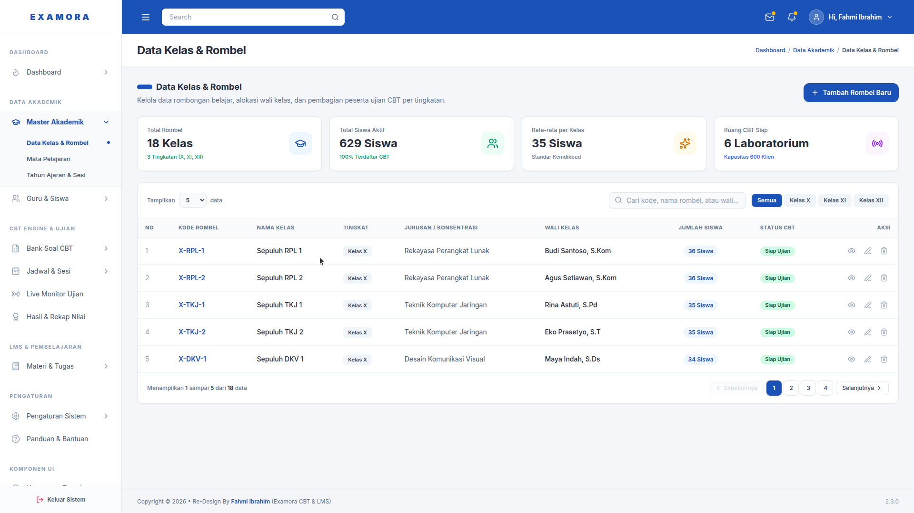

# Velora UI — Modern Admin Dashboard Template



<p align="center">
  <b>Modern, Clean, and Ultra-Responsive React Admin Dashboard Template inspired by Stisla.</b>
  <br />
  Dibangun menggunakan React 19, Vite, Tailwind CSS v4, TypeScript, dan Lucide Icons.
</p>

<p align="center">
  
  
  
  
  
</p>

---

## 🌟 Tentang Velora UI

**Velora UI** adalah template dashboard admin modern yang dirancang khusus untuk kenyamanan visual dan kecepatan performa. Mengusung filosofi desain **Clean Executive White Cards**, tipografi kontras tinggi, serta navigasi interaktif canggih:
- **Collapsible Mini Sidebar**: Dapat diperkecil menjadi mode ringkas dengan ikon berbingkai rapi.
- **Hover Flyout Submenu**: Menu dropdown otomatis muncul melayang di sebelah sidebar ketika sidebar dalam mode ringkas (collapsed).
- **Tooltip Presisi**: Tooltip gelap elegan dengan arrow indicator untuk menu biasa saat sidebar diperkecil.
- **Tabel Interaktif**: Dilengkapi fitur pencarian real-time, filter kategori, show entries per page (5, 10, 25, 50, 100), dan navigasi pagination dinamis.
- **Standalone Ready**: Menggunakan data mock terpadu, template ini **langsung jalan** tanpa perlu setting backend/database terlebih dahulu!

---

## 🛠️ Tech Stack & Dependencies

| Teknologi | Keterangan |
|---|---|
| **[React 19](https://react.dev/)** | Library UI modern dengan performa render optimal |
| **[Vite 8](https://vite.dev/)** | Build tool generasi terbaru super kilat untuk HMR |
| **[Tailwind CSS v4](https://tailwindcss.com/)** | Framework CSS utility-first generasi terbaru tanpa config rumit |
| **[TypeScript](https://www.typescriptlang.org/)** | Type-safe, autocompletion rapi, dan mudah dirawat |
| **[Lucide React](https://lucide.dev/)** | Koleksi icon modern, ringan, dan konsisten |
| **[TanStack Query v5](https://tanstack.com/query/latest)** | Data fetching, caching, dan state management |
| **[SweetAlert2](https://sweetalert2.github.io/)** | Notifikasi modal & konfirmasi interaktif yang elegan |

---

## 🚀 Panduan Instalasi & Menjalankan (Untuk Pemula)

Panduan langkah demi langkah ini dibuat agar **siapa saja (termasuk orang awam)** dapat menjalankan template ini di komputernya dalam hitungan menit.

### 1. Prasyarat (Prerequisites)
Pastikan di komputer Anda sudah terpasang salah satu runtime berikut:
- **Node.js** (Versi 18 ke atas) &mdash; Unduh di [nodejs.org](https://nodejs.org/)
- *Atau* **Bun** (Rekomendasi tercepat) &mdash; Unduh di [bun.sh](https://bun.sh/)

Untuk memeriksa apakah sudah terpasang, buka **Terminal** (Mac/Linux) atau **Command Prompt / PowerShell** (Windows), lalu ketik:
```bash
node -v
# atau jika menggunakan Bun:
bun -v
```

---

### 2. Unduh / Clone Repository
Buka terminal dan jalankan perintah berikut untuk mengunduh project:

```bash
git clone https://github.com/fahmiibrahimdevs/velora-ui.git
```

Setelah selesai, masuk ke dalam folder project:
```bash
cd velora-ui
```

---

### 3. Install Dependensi Paket
Jalankan salah satu perintah di bawah ini sesuai package manager yang Anda gunakan:

**Menggunakan Bun (Paling Cepat):**
```bash
bun install
```

**Atau menggunakan NPM (Bawaan Node.js):**
```bash
npm install
```

**Atau menggunakan PNPM / Yarn:**
```bash
pnpm install
# atau
yarn install
```

*Tunggu beberapa detik hingga seluruh paket selesai diunduh.*

---

### 4. Menjalankan Server Development
Setelah dependensi terpasang, jalankan server lokal:

**Jika menggunakan Bun:**
```bash
bun run dev
```

**Jika menggunakan NPM:**
```bash
npm run dev
```

Terminal akan menampilkan link lokal seperti berikut:
```text
  VITE v8.x.x  ready in 150 ms

  ➜  Local:   http://localhost:5173/
  ➜  Network: use --host to expose
```

---

### 5. Buka di Browser
Buka browser favorit Anda (Google Chrome, Firefox, Safari, atau Edge), lalu kunjungi alamat:
👉 **`http://localhost:5173`**

Selamat! Dashboard admin **Velora UI** sudah berhasil berjalan di komputer Anda! 🎉

---

## 📦 Build untuk Production

Jika Anda ingin menghasilkan file statis yang siap di-upload ke server hosting (seperti Vercel, Netlify, VPS, atau cPanel):

```bash
# Menggunakan Bun:
bun run build

# Atau menggunakan NPM:
npm run build
```

Hasil build akan otomatis tersimpan di folder `dist/`. Anda cukup meng-upload isi folder `dist/` tersebut ke web server Anda.

---

## 📂 Struktur Folder Project

```text
velora-ui/
├── public/                # File statis publik (favicon, logo, dll)
├── src/
│   ├── components/        # Komponen UI modular
│   │   ├── layout/        # Navbar, Sidebar, AdminLayout, Breadcrumb
│   │   └── ...            # Komponen Alert, Badge, Card, Modal, dll
│   ├── hooks/             # Custom React Hooks & query data
│   ├── lib/               # Utility helper (SweetAlert2, formatter)
│   ├── types/             # Deklarasi tipe data TypeScript
│   ├── App.tsx            # Halaman utama & routing tampilan
│   ├── main.tsx           # Entry point aplikasi
│   └── index.css          # Setup Tailwind CSS v4 & custom style
├── preview.png            # Screenshot preview template untuk README
├── package.json           # Konfigurasi dependensi project
├── tsconfig.json          # Konfigurasi TypeScript
├── vite.config.ts         # Konfigurasi Vite bundler
└── README.md              # Dokumentasi project
```

---

## 🎨 Kustomisasi Mudah

- **Mengubah Warna Utama**: Buka `src/index.css` atau ubah kelas warna Tailwind (`#1351b8` atau blue palette) di komponen terkait.
- **Menambah Menu Sidebar**: Buka `src/components/layout/Sidebar.tsx` dan tambahkan menu baru pada array navigasi.
- **Mengubah Profil / Logo**: Buka `src/components/layout/Navbar.tsx` dan `src/components/layout/Sidebar.tsx`.

---

## 📄 Lisensi

Project ini dilisensikan di bawah lisensi [MIT License](LICENSE). Anda bebas menggunakan, memodifikasi, dan mendistribusikan template ini baik untuk keperluan pribadi maupun komersial.

---

<p align="center">
  Crafted with ❤️ by <a href="https://github.com/fahmiibrahimdevs"><b>Fahmi Ibrahim</b></a>
</p>
